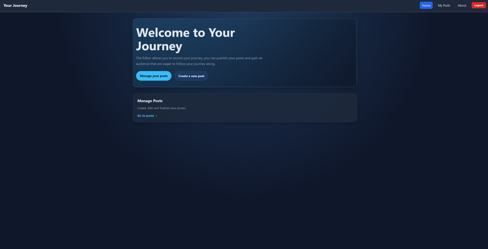

# Blog API

A RESTful Blog API built as part of The Odin Project’s Node.js curriculum. The project focuses on creating a functioning API with basic CRUD operations for blog posts, comments, and user/admin content management.

## Features

- Create, read, update, and delete blog posts
- Viewing post details
- Grouping posts by author
- Authenticate users with JWT
- Protected routes
- Input validation

## Skills demonstrated

- **REST API design:** building endpoints for blog content and comments
- **Backend development:** creating Express routes, controllers, and middleware
- **Database management:** storing and retrieving data with PostgreSQL
- **Authentication:** securing routes with JWT-based login
- **Data validation:** checking request data before saving it
- **Error handling:** handling invalid requests and missing resources

## Tech stack

- Node.js
- Express
- PostgreSQL
- React
- JSON Web Tokens (JWT)

[Blog Backend](https://github.com/R-Clarkey/Odin_Blog_Backend)

[Blog Viewer](https://github.com/R-Clarkey/Odin_Blog_Viewer)
